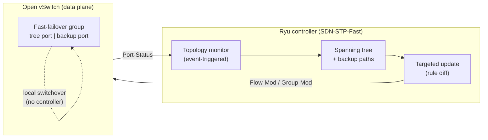

# SDN-STP-Fast: fast, centralized loop prevention for local and IoT networks

Ryu (OpenFlow 1.3) applications that prevent Layer-2 loops with a spanning tree computed by
the SDN controller, and an automated Mininet framework that compares them with the
distributed IEEE 802.1D STP and RSTP of Open vSwitch after link failures and root-bridge
failures.

This is the software of the paper *Resilient and Reconfigurable Fast Loop Prevention for
Local and IoT Networks Using Software-Defined Networking* (J. Moura, submitted to IEEE Access).


%20%7C%203.12%20(Mininet)-informational)


## What it does

**SDN-STP** (`controllers/DynSTPProactive.py`) builds a graph of the network from Ryu's
topology service and the hosts it learns, computes a spanning tree, and enforces it in three
places:

1. **Flooding:** broadcast traffic only leaves through ports of the tree.
2. **Proactive rules:** unicast and ARP rules are validated against the tree before they are installed.
3. **Packet-In processing:** packets arriving on ports outside the tree are dropped.

It recomputes the tree periodically, and buffers the Packet-In messages received while the tree changes.

**SDN-STP-Fast** (`controllers/DynSTPProactiveFast5.py`) keeps the same tree and enforcement,
and adds three mechanisms that take the controller out of the recovery path:

| Mechanism | What it does |
|---|---|
| Fast-failover protection | Every unicast rule outputs to an OpenFlow fast-failover group: tree port + backup port. The backup path avoids the next switch (node protection) and its rules are installed in advance, so the switch moves the traffic by itself when a port goes down. |
| Event-triggered recomputation | Port-Status and link events wake the topology monitor (10 ms holdoff); down ports are excluded at once; only links seen in both directions are used. |
| Targeted make-before-break update | The controller keeps the installed rule set, computes the new one and sends only the difference: new rules first, then strict deletions; the backup paths are replaced without loss. |



## Example results

These are means over 5 runs per configuration in a Mininet VM with two vCPUs, measured with UDP traffic. The interruption is measured at the failure.

| Scenario | 802.1D STP | RSTP | SDN-STP | SDN-STP-Fast without FF | **SDN-STP-Fast** |
|---|---|---|---|---|---|
| Link failure, triangle, 1–50 Mbit/s | 44–50 s | 10–26 ms | 0.48–1.16 s | – | **2–10 ms** |
| Root-bridge failure, ring of 6 switches, 50 Mbit/s | ≈ 50 s | 22 ms | – | 144 ms | **6 ms** |

## Repository layout

```
controllers/
  DynSTPProactive.py        SDN-STP (original application)
  DynSTPProactiveFast5.py   SDN-STP-Fast (paper version)
  DynSTPProactiveFast3.py   SDN-STP-Fast without fast-failover groups (ablation)
  DynSTPProactiveFast.py, ...Fast2.py, ...Fast4.py   intermediate versions, kept for reference
experiments/
  run_experiments.py        builds the topology, injects failures, runs the traffic, writes CSVs
  udp_probe.py              constant-bit-rate UDP sender/receiver (kernel receive timestamps)
  failwin.py                interruption at the failure (used by the analyzer)
  analyze_results.py        tables (LaTeX), plot data, LaTeX macros and summary.md
  ryu-manager.example       wrapper to run Ryu from its own Python environment as root
labs/
  spanning_tree_sdn.py      triangle topology with a remote controller (interactive lab)
  spanning_tree_stp.py      triangle topology with OVS 802.1D STP (interactive lab)
```

| Mode (`--modes`) | Controller / bridge | Name in the paper |
|---|---|---|
| `sdn` | DynSTPProactive.py | SDN-STP |
| `sdnfast5` | DynSTPProactiveFast5.py | SDN-STP-Fast |
| `sdnfast3` | DynSTPProactiveFast3.py | SDN-STP-Fast (no FF) |
| `stp` | OVS standalone, 802.1D | 802.1D STP |
| `rstp` | OVS standalone, RSTP | RSTP |
| `sdnfast`, `sdnfast2`, `sdnfast4` | intermediate versions | – |

## Requirements

- Ubuntu 22.04/24.04 (the paper used Ubuntu 24.04 in VirtualBox, 2 vCPUs, 8 GB RAM)
- Mininet 2.3.0 and Open vSwitch 3.x (kernel datapath)
- Ryu 4.34 in a **Python 3.9** environment (Ryu does not run on recent Python versions);
  NetworkX in the same environment
- Python 3 with NetworkX for the experiment and analysis scripts

```bash
# Mininet and Open vSwitch
sudo apt install mininet openvswitch-switch python3-networkx

# Ryu in its own Python 3.9 environment (example with pyenv)
pyenv install 3.9.18
pyenv virtualenv 3.9.18 ryu-env
pyenv activate ryu-env
pip install -r requirements-ryu.txt

# let run_experiments.py (which runs as root) find this ryu-manager
cp experiments/ryu-manager.example experiments/ryu-manager
nano experiments/ryu-manager          # set the path of your ryu-manager
chmod +x experiments/ryu-manager
```

## Quick start (interactive lab)

```bash
# terminal 1: the controller
ryu-manager --observe-links controllers/DynSTPProactiveFast5.py

# terminal 2: the triangle topology
sudo python3 labs/spanning_tree_sdn.py
mininet> pingall
mininet> link s1 s3 down        # watch the controller log and the fast-failover groups
mininet> sh ovs-ofctl -O OpenFlow13 dump-groups s1
```

## Running the experiments

All commands are run from `experiments/`. Results are appended to `results/` (one CSV row
per run, raw logs in `results/raw/`); runs that are already in the CSV are skipped, so an
interrupted campaign can be resumed.

```bash
cd experiments

# link failure in the triangle: ICMP (6 intervals) and UDP (5 rates), 5 repetitions
sudo python3 run_experiments.py --modes sdn sdnfast5 stp rstp
python3 analyze_results.py --results ../results

# root-bridge failure in a ring of six switches (s1 root fails, s4 becomes root)
sudo python3 run_experiments.py --scenario ring6-root --modes stp rstp sdnfast3 sdnfast5 \
        --tests udp --rates 25 50 --reps 5
python3 analyze_results.py --results ../results/ring6-root \
        --modes stp,rstp,sdnfast3,sdnfast5 --macro-prefix Root
```

Main options of `run_experiments.py`:

| Option | Values | Meaning |
|---|---|---|
| `--topo` | `triangle`, `ring6`, `ring7`, `mesh6` | topology (one host per switch, port 1) |
| `--pair` | `fixed`, `longest` | h1→h3, or the hosts with the longest path on the active tree |
| `--failure` | `link`, `switch` | fail the middle link of the path, or a whole switch (all its links at once) |
| `--scenario` | `ring6-root` | controlled root failure: bridge priorities, SDN link costs, h2→h6, s1 fails |
| `--tests`, `--intervals`, `--rates`, `--reps` | | traffic and repetitions |
| `--src`, `--dst`, `--fail-switch`, `--bridge-priorities`, `--sdn-link-costs` | | build your own scenario |

**Metrics.** For UDP, the receiver takes the kernel receive timestamp of every datagram and
counts, per 10 ms of send time, the datagrams that arrived on time, late (more than 10 ms) or
never. The interruption is the longest run of disrupted 10 ms intervals that starts at the
failure, so pauses of the VM at the sender or the receiver are not counted. For ICMP, it is
the longest gap between replies that starts at the failure, or the longest run of lost probes,
whichever is longer.

**Tips for long campaigns.**
- **Keep the machines awake:** disable sleep on the host and in the VM.
- **Watch for problems:** `grep -c "Topology update failed"` on the controller logs should print 0.
- **Remove partial runs:** to re-run a configuration, delete its rows from the CSV first, for example `sudo sed -i '/^sdnfast5,/d' results/udp_runs.csv`.

## Notes and limitations

- **Message order.** The make-before-break order relies on Open vSwitch applying the messages of one OpenFlow connection in order. Switches that may reorder messages need a barrier between the new rules and the deletions.
- **Single-failure protection.** The fast-failover groups protect each path against one failure. A second failure before the update completes falls back to the controller.
- **Test scale.** The scripts assume one host per switch on port 1 and hosts learned from ICMPv6 messages, as in Mininet.

## Citation

If you use this software, please cite the paper (see `CITATION.cff`).

## License

MIT. See `LICENSE`.
